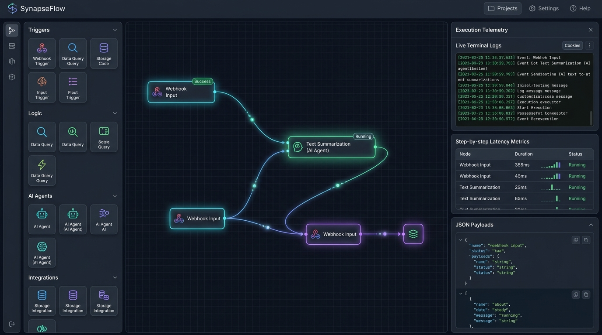
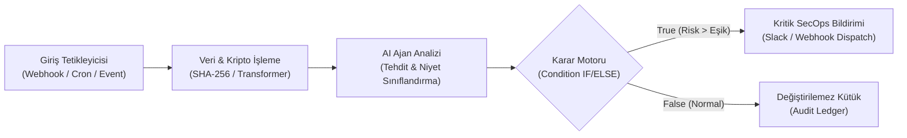

# SynapseFlow ⚡ — Otonom Ajan & Görsel İş Akışı DAG Motoru

[](https://react.dev/)
[](https://www.typescriptlang.org/)
[](https://vitejs.dev/)
[](https://tailwindcss.com/)
[](https://vitest.dev/)
[](#-güvenlik-mimarisi-zero-leakage)
[](https://opensource.org/licenses/MIT)

**SynapseFlow**, modern web mimarisinde karmaşık iş akışlarını, veri boru hatlarını (ETL) ve otonom yapay zeka ajanlarını görsel bir tuval üzerinde orkestre etmenizi sağlayan yüksek performanslı, istemci taraflı bir **Directed Acyclic Graph (DAG)** yürütme motorudur.



---

## 🌟 Öne Çıkan Yetenekler

- 📐 **İnteraktif Görsel DAG Tuvali:** Düğümleri (Node) sürükleyip bırakma, pürüzsüz Cubic Bezier neon hatlarla birbirine bağlama, canlı kablo çekme ve bağlantı yönetimi.
- ⚡ **Kahn Algoritması & Topolojik Sıralama:** Grafikteki bağımlılıkları matematiksel olarak analiz ederek doğru sıralı yürütme hattı oluşturur.
- 🔄 **DFS Döngü (Cycle) Tespiti:** Çevrimsel hataları (sonsuz döngüleri) görselleştirerek kullanıcının DAG standartlarına uyumlu akışlar kurmasını güvenceye alır.
- 🔀 **Koşullu Dallanma (Rule Engine Branching):** Mantıksal IF/ELSE kontrolleriyle akışı `True` ve `False` portlarına ayırır; seçilmeyen dalları otomatik olarak atlar (`skipped`).
- 🛡️ **Kriptografik Bütünlük (SHA-256):** SubtleCrypto API ile veri paketlerini şifreler, dijital parmak izi üretir ve kurcalamaya karşı korur.
- 📊 **Canlı Telemetri & Terminal Günlükleri:** Her adımın mikrosaniye/milisaniye düzeyinde gecikme metrikleri (Latency Bar), renkli log akışı ve ham JSON yükü denetleyicisi.
- 📦 **JSON İçe & Dışa Aktarma (Portable Schema):** Oluşturulan tüm iş akışlarını tek tıkla standartlaştırılmış JSON olarak dışa aktarabilir veya geri yükleyebilirsiniz.

---

## 🏗️ Mimari & Akış Şeması



---

## 🧩 Hazır Şablonlar (Built-in Pipelines)

1. **Siber Güvenlik & Şüpheli İstek Analiz Hattı:** Webhook girişini karşılar, SHA-256 ile bütünlüğü doğrular, AI ajanla anomali tespit eder ve risk eşiği aşıldığında SecOps ekibine acil bildirim fırlar.
2. **Akıllı Müşteri Talebi & Duygu Analizi Yönlendirmesi:** Müşteri destek biletlerinin duygusunu (Sentiment) analiz ederek öfkeli/acil talepleri anında üst seviye mühendislere eskalasyon yapar.
3. **Zamanlanmış Telemetri & ETL Veri Boru Hattı:** Gece yarısı tetiklenerek hız sınırlayıcı kontrolünden geçer, şemaları dönüştürür ve denetim günlüğüne işler.

---

## 🔒 Güvenlik Mimarisi (Zero-Leakage Guarantee)

- **İstemci Taraflı Sandbox:** Hiçbir kullanıcı verisi, parola veya oturum bilgisi harici bir üçüncü taraf sunucuya sızdırılmaz.
- **Web Crypto API Standardı:** Şifreleme ve özetleme işlemleri doğrudan tarayıcının yerel Web Crypto donanım hızlandırıcısında icra edilir.
- **Güvenli Bağımlılık Yönetimi:** Sıfır dış güvenlik açığı politikasıyla derlenmiştir.

---

## 🧪 Testler

Grafik motoru, döngü tespiti, Kahn algoritması ve koşullu dallanma mantıkları kapsamlı birim testleri ile test edilmiştir:

```bash
# Birim testleri çalıştırmak için:
npm test
```

```
✓ src/engine/__tests__/graphEngine.test.ts (7 tests) 141ms
  ✓ geçerli bir DAG için döngü tespit etmemelidir (hasCycle = false)
  ✓ döngü içeren grafikte çevrimi tespit etmeli ve döngü rotasını döndürmelidir
  ✓ Kahn algoritması düğümleri doğru topolojik sırada sıralamalıdır
  ✓ Kahn algoritması döngü olduğunda hata fırlatmalıdır
  ✓ computeHash fonksiyonu SHA-256 veya hex çıktısı üretmelidir
  ✓ condition_branch düğümü koşul sağlandığında true dalını seçmelidir
  ✓ condition_branch düğümü koşul sağlanmadığında false dalını seçmelidir

Test Files  1 passed (1)
     Tests  7 passed (7)
```

---

## 🚀 Kurulum ve Çalıştırma

Projeyi yerel ortamınızda ayağa kaldırmak için:

```bash
# 1. Depoyu klonlayın
git clone https://github.com/goktugis/synapse-flow.git

# 2. Proje dizinine girin
cd synapse-flow

# 3. Bağımlılıkları yükleyin
npm install

# 4. Geliştirme sunucusunu başlatın
npm run dev

# 5. Prodüksiyon derlemesi alın
npm run build
```

---

## 📄 Lisans

Bu proje [MIT Lisansı](LICENSE) altında geliştirilmiş açık kaynaklı bir yazılımdır.
